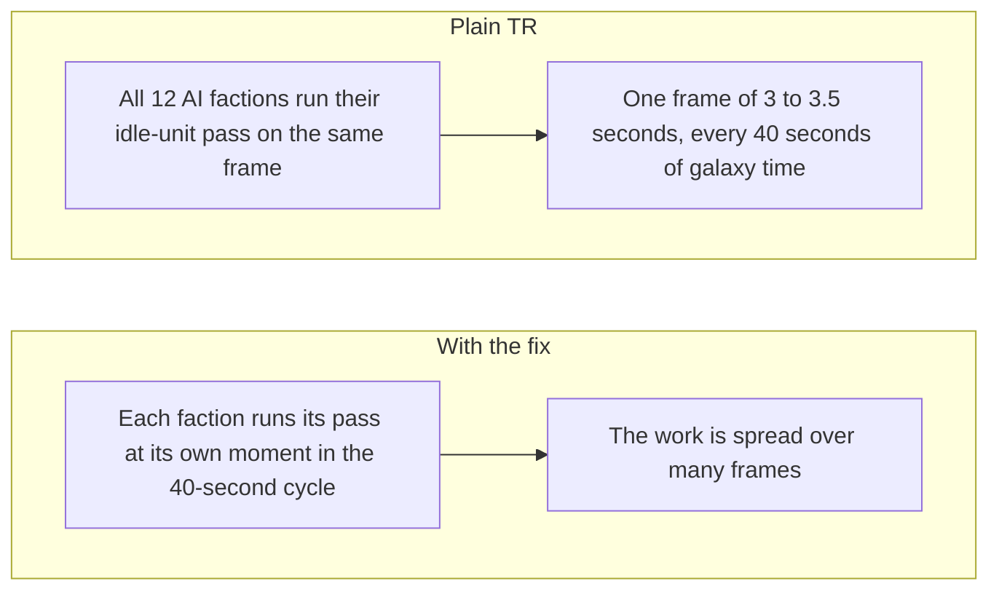

# EaWX-Optimizer

Lag fixes for galactic mode in Thrawn's Revenge (TR), an EaWX mod for Star Wars: Empire at War: Forces of Corruption, with the data behind them.

<table>
  <tr><th>Measured in plain TR</th><th>With the Full fix</th></tr>
  <tr><td>Mean frame time: <strong>29.4 ms</strong> (about 34 fps)</td><td><strong>12.4 ms</strong> (about 81 fps), 58 percent less time per frame</td></tr>
  <tr><td>Slowest frame per run: <strong>1.3 to 2.3 seconds</strong></td><td><strong>0.24 to 0.30 seconds</strong></td></tr>
</table>

The Workshop version is the Full fix without the AI pause and the hero change, so the AI plans goals and moves heroes as often as in TR. That build wasn't timed; by my rough estimate it's 2 to 4 ms a frame slower without the pause (see the write-up).

Play it: [Steam Workshop](https://steamcommunity.com/sharedfiles/filedetails/?id=3832007002). Full write-up: [TR galactic lag](https://molosat.github.io/EaWX-Optimizer/). Frame timer used for the measurements: [alamo-profiler](https://github.com/molosat/alamo-profiler).

<picture>
  <source media="(prefers-color-scheme: dark)" srcset="docs/img/mean-frame-time-dark.svg">
  
</picture>

Each dot is a fresh game; the tick marks the average and the shaded band shows its uncertainty.

<picture>
  <source media="(prefers-color-scheme: dark)" srcset="docs/img/stutters-dark.svg">
  
</picture>

The bars show stutters per minute of real play time, with a separate scale for each panel.

<picture>
  <source media="(prefers-color-scheme: dark)" srcset="docs/img/longest-frame-dark.svg">
  
</picture>

Each dot shows the slowest logged frame in a game.

<picture>
  <source media="(prefers-color-scheme: dark)" srcset="docs/img/ai-planets-dark.svg">
  
</picture>

Each dot is the average planet count for that version, and the line spans the lowest to highest count.



I measured 10 fresh games per version for 120 galactic seconds each, at 1920x1080 on one PC.

The [write-up](https://molosat.github.io/EaWX-Optimizer/) covers the full story, the limits and what did not work.

## What's here

| folder | contents |
|---|---|
| `submod/` | the Python script that builds the submod from your own copy of TR, and its tests |
| `layers/tr-freestore-stagger/` | the stagger code the script reuses |
| `data/main-study/` | the main study |
| `data/order-cap/` | the order-cap test, a change that didn't make the fix |
| `data/dll-cost/` | the test of what the frame timer costs |
| `docs/` | the write-up |

Each study folder has its plan (`PREREGISTRATION.md`, except the order-cap test), any deviations, its results and the analysis script. The frame timer is a separate project: [alamo-profiler](https://github.com/molosat/alamo-profiler).

This repo has no TR files. The script reads them from your install and checks each one against the exact version the changes were written for, so it stops if TR has changed.

## Build the submod

You need Python 3 and a copy of TR. The script uses only the standard library. The second folder is the output: use a new one outside TR.

```bash
python -I -B submod/make_submod.py "<TR folder>" "<output folder>" --only stagger,search-memo,factoring,common-factors,native-groups
```

That list is the version on the Workshop. Add `sleep,hero-cadence` to build the Full fix as tested. To test a build, load it ahead of TR with `Modpath=<output folder> Modpath=<TR folder>`. Single-player only.

## Run the tests and analyses

```bash
python -I -B -m unittest discover -s submod
```

Set `TR_FOLDER` to your TR folder to run the test that needs TR's own script. Tests that need a Lua runner, which isn't published, skip themselves.

Run each analysis from its study folder. The output should match that folder's `analysis.txt`.

```bash
python -I -B analyze.py runs.jsonl
```

In `order-cap`, use `ab-runs.jsonl`. In `dll-cost`, run it with no argument.

## What changed in the data for publication

The numbers are untouched. The study notes were edited to remove references to unpublished runs, the window size used for exploratory tests and the exact hardware. Local paths were replaced with neutral names (`TR`, `core-fixes-layer`, `full-fix-layer`) or `<local path>`, and references to scripts that aren't published were reworded. The gzip wrappers on the frame logs were rewritten without their file times. Layer folders in the older files use the names above. Run dates and clock times were removed from the logs and notes, log timestamps were turned into elapsed time, and the original capture file names in the run records were replaced with the published file names.

Commit hashes in the plans point to the private history this repo was cut from. That history isn't published, so the commit dates of the plans can't be checked here. The test driver isn't published either, because it depends on private tooling.

## License

MIT, for the code and data in this repo. Thrawn's Revenge and Empire at War belong to their owners.
